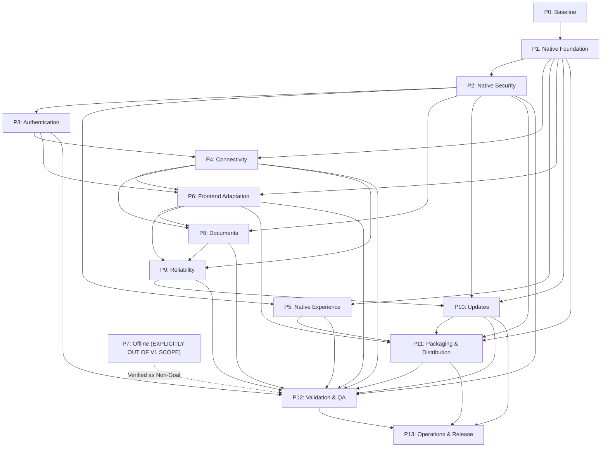

# EDUPULSE ERP — Windows Desktop v1
## Engineering Implementation Specification
### 14 phases • Work packages • Dependencies • Acceptance criteria • Test evidence
**Version 1.0 | 13 November 2026**

---

## Document control

| Field | Baseline |
| :--- | :--- |
| **Status** | Scope locked; implementation status must be verified from source and test evidence. |
| **Framework** | Tauri 2 + Rust |
| **Frontend** | Existing React + TypeScript application (`frontend-v2`) |
| **Backend** | Existing Spring Boot SaaS APIs (`backend/`) |
| **Database** | Existing cloud PostgreSQL; desktop does not connect directly. |
| **Platform** | Windows only for v1 |
| **Connectivity** | Online-first; internet/backend required for ERP operations. |
| **Offline** | No offline ERP database, offline writes, mutation queue or synchronization in v1. |
| **Distribution** | Public download from official EduPulse website. |
| **Updates** | Signed update artifacts and controlled release pipeline. |

---

## How to use this specification

- Treat this as the definition of scope and completion, not proof that any phase is complete.
- Use phase/work-package IDs in issues, pull requests, test reports and release records.
- Mark a work package **Done** only when its acceptance criteria pass and evidence is attached.
- Inspect current source and Git history before assuming reported commits or features are complete.
- Preserve the existing SaaS web application; shared changes must pass browser regression tests.
- Do not touch production services, databases, signing credentials or public release channels without explicit authorization.

---

## 1. Locked scope and non-goals

| Decision | Locked v1 definition | Consequence |
| :--- | :--- | :--- |
| **Platform** | Windows desktop only | macOS/Linux are excluded from v1. |
| **Runtime** | Tauri 2 + Rust | Native commands must be minimal and permissioned. |
| **Frontend** | Existing React + TypeScript | Reuse shared UI and business logic. |
| **Backend** | Existing Spring Boot SaaS backend | Backend remains authoritative for auth, tenant context and business rules. |
| **Database** | Cloud PostgreSQL | No direct desktop-to-database connection. |
| **Connectivity** | Online-first | ERP operations require backend connectivity. |
| **Disconnected behavior** | Graceful degradation only | Show status, preserve safe UI state, explain failed actions and recover on reconnect. |
| **Offline capability** | None for ERP operations | No local ERP DB, deferred mutation queue or sync engine. |
| **Distribution** | Public website download | Signed installer, integrity verification and update security required. |

### Explicit non-goals
1. Full or partial offline ERP operation, offline editing, background synchronization or local institutional data replication.
2. Separate desktop-only business rules, APIs or database schema.
3. macOS, Linux, mobile or browser-extension releases.
4. Embedding API secrets, database credentials, privileged tokens or signing private keys in the client.
5. Claiming DPAPI protects against malicious code running inside the authenticated desktop process.

---

## 2. Architecture boundaries

| Layer | Responsibility | Security rule |
| :--- | :--- | :--- |
| **React UI** | Screens, forms, navigation and transient client state | Treat frontend input as untrusted; no long-lived token persistence in desktop browser storage. |
| **Tauri IPC** | Typed bridge to native capabilities | Deny by default; expose only necessary commands to trusted app context. |
| **Rust native layer** | Credential vault and selected Windows integrations | Validate arguments; no arbitrary shell or unrestricted filesystem commands. |
| **Windows Credential Manager / DPAPI** | Credential protection at rest | Protection is scoped to Windows user context; not a defense against runtime compromise. |
| **Spring Boot** | Authentication, authorization, tenant context and ERP rules | Server remains authoritative; never trust client-supplied tenant routing. |
| **Cloud PostgreSQL** | Authoritative ERP/platform data | Desktop must not connect directly to the database. |
| **Official website / CDN** | Installer and update distribution | HTTPS, signed artifacts, checksums and controlled publishing. |

---

## 3. Cross-cutting engineering rules

1. Least privilege for IPC, plugins, navigation, filesystem and protocol handlers.
2. Typed, bounded and validated Rust command inputs; explicit error results.
3. Production HTTPS only; never disable certificate validation.
4. Never log passwords, tokens, cookies, authorization headers or sensitive ERP payloads.
5. Keep web and Tauri runtime adapters separate; browser builds must not require Tauri at module-load time.
6. Use idempotency keys or status reconciliation for mutations; never blindly retry financial or academic writes.
7. Because v1 is online-only, minimize local persistence of institutional data.
8. Record dependency/toolchain versions and produce traceable, reproducible builds.
9. Any exception to an acceptance criterion requires rationale, risk owner, mitigation and review date.

---

## Phase Specifications (P0 to P13)

### P0 — Repository and architecture baseline
- **Objective:** Verify the actual repositories, code paths, build chain, auth lifecycle and current risks before further implementation.
- **Dependencies:** None.
- **Exit gate:** A clean checkout can be built and the current architecture and defects are evidenced.

#### P0.1 — Repository and Git inventory
- **Tasks:**
  - Identify parent/nested repositories, remotes, branches, HEADs, working-tree state and ignored files.
  - Map authoritative frontend and Tauri paths; inspect reported commits 51–53 and their diffs.
  - Check tracked secrets, binaries, generated artifacts and repository boundaries.
- **Acceptance criteria:**
  - Repository map and Git state are documented.
  - Reported work is reconciled against source; no user changes are overwritten.
- **Required tests / evidence:**
  - Capture `git status`/`log`/`remotes` and commit diffs.
  - Run secret scan and inspect tracked artifacts.
- **Deliverable:** Repository baseline and Git safety report.

#### P0.2 — Build and test baseline
- **Tasks:**
  - Record Java, Node, package manager, Rust, Cargo, Tauri CLI, WebView2 and Windows versions.
  - Run frontend lint, typecheck, unit tests and production build.
  - Run Rust fmt, clippy and tests; run backend tests relevant to auth/API.
  - Separate existing failures from new failures.
- **Acceptance criteria:**
  - Clean-checkout commands are reproducible.
  - All baseline failures have issue IDs and owners.
- **Required tests / evidence:**
  - Retain frontend/Rust/backend logs and build artifacts.
  - Repeat from a clean checkout or CI runner.
- **Deliverable:** Build/test baseline and toolchain manifest.

#### P0.3 — Architecture and API contract audit
- **Tasks:**
  - Map React routing, state management, auth store and runtime imports.
  - Map Tauri commands, capabilities, plugins, CSP and navigation.
  - Trace login, refresh, logout, revocation, disabled-user checks and API base URL.
  - Identify web-only and desktop-only code paths.
- **Acceptance criteria:**
  - Architecture diagram reflects source, not assumptions.
  - Auth/token lifecycle and API contracts are documented.
- **Required tests / evidence:**
  - Trace login through API, Zustand, IPC and vault.
  - Build browser and Tauri targets.
- **Deliverable:** Desktop architecture baseline and API/auth contract.

---

### P1 — Native desktop foundation
- **Objective:** Build a Windows desktop shell that runs from packaged assets without a development server.
- **Dependencies:** P0.
- **Exit gate:** Packaged app launches on a clean supported Windows machine.

#### P1.1 — Tauri application shell
- **Tasks:**
  - Confirm Tauri 2 structure, Rust entry point and React asset integration.
  - Set product name, bundle identifier, version, window title, minimum size and lifecycle.
  - Separate dev/staging/production build configuration; remove dev-only behavior from production.
- **Acceptance criteria:**
  - Production app launches without Vite dev server.
  - Window lifecycle works and no dev endpoint is required.
- **Required tests / evidence:** Launch dev and packaged builds with dev server stopped; inspect packaged resources and logs.
- **Deliverable:** Reproducible Tauri shell and build scripts.

#### P1.2 — Windows runtime compatibility
- **Tasks:**
  - Define supported Windows versions and architectures.
  - Define WebView2 runtime/bootstrapper strategy.
  - Test standard-user install and clean VM without developer tools.
  - Provide actionable errors for missing/incompatible runtime.
- **Acceptance criteria:** Supported OS matrix is published; runtime prerequisites and failure recovery are documented.
- **Required tests / evidence:** Clean VM install across supported Windows versions; test WebView2 present/missing and standard-user behavior.
- **Deliverable:** Windows compatibility matrix.

#### P1.3 — Identity and lifecycle
- **Tasks:**
  - Configure icon, publisher metadata, version display and About view.
  - Decide single-instance versus multi-instance behavior.
  - Handle startup, close, focus, restore and multi-monitor bounds.
- **Acceptance criteria:** Identity is consistent in installer and OS surfaces; no orphan processes; window restores within valid display bounds.
- **Required tests / evidence:** Repeated launch/close; multi-monitor; upgrade over prior install.
- **Deliverable:** Lifecycle behavior and implementation.

---

### P2 — Native security foundation
- **Objective:** Secure the native credential store, IPC surface, WebView and release secrets.
- **Dependencies:** P1.
- **Exit gate:** Security review verifies least-privilege native commands and safe credential handling.

#### P2.1 — Credential vault hardening
- **Tasks:**
  - Review existing keyring integration and service/account identifiers.
  - Define account-scoped vault keys for multiple EduPulse identities under one Windows profile.
  - Define access/refresh token storage policy and rotation behavior.
  - Return typed success/failure results; distinguish missing entry from vault failure.
  - Make deletion verifiable; handle unavailable/corrupt Credential Manager state.
- **Acceptance criteria:**
  - No desktop JWT persistence in `localStorage`/`sessionStorage`.
  - Vault failures are explicit and cannot masquerade as success.
  - Multiple EduPulse accounts cannot overwrite each other's credentials unintentionally.
- **Required tests / evidence:** Store/read/delete round trip; two accounts on one Windows profile; vault unavailable, denied access, corrupt entry and deletion failure; restart and verify intended persistence.
- **Deliverable:** Credential vault API, tests and threat notes.

#### P2.2 — IPC and capability minimization
- **Tasks:**
  - Inventory commands/plugins and define allowlist.
  - Restrict commands to trusted app windows/origins.
  - Validate input types, lengths and state transitions in Rust.
  - Remove unused plugins, broad filesystem/shell permissions and arbitrary command execution.
- **Acceptance criteria:** Only required commands are exposed; malformed/oversized inputs are rejected; untrusted contexts cannot invoke privileged commands.
- **Required tests / evidence:** Attempt IPC from disallowed origin/window; fuzz malformed inputs; review capability manifest.
- **Deliverable:** IPC inventory, capability policy and tests.

#### P2.3 — WebView, CSP and navigation
- **Tasks:**
  - Set strict production CSP compatible with app features.
  - Restrict navigation and external URL opening to approved destinations/schemes.
  - Block unnecessary remote content and unsafe protocols.
  - Review deep links/custom protocols and production devtools/debug settings.
- **Acceptance criteria:** CSP enforced in production; untrusted origins cannot inherit privileged capabilities; external navigation is constrained.
- **Required tests / evidence:** CSP violation tests; open redirect tests; javascript/file/data/unknown scheme tests.
- **Deliverable:** Production WebView security configuration.

#### P2.4 — Secrets, logs and dependencies
- **Tasks:**
  - Implement structured logging and redaction.
  - Prevent token/header/password/document leakage.
  - Audit npm/Cargo dependencies and lockfiles.
  - Keep signing keys only in protected CI/signing infrastructure.
- **Acceptance criteria:** No secrets in logs, source or bundled assets; dependency findings are triaged; release keys are not bundled.
- **Required tests / evidence:** Synthetic secret log test; secret scan; npm/Cargo audit.
- **Deliverable:** Logging policy, dependency inventory and remediation register.

---

### P3 — Authentication and session lifecycle
- **Objective:** Complete login, token rotation, logout, session recovery and account-state enforcement across frontend, Tauri and backend.
- **Dependencies:** P2 and agreed backend auth contract.
- **Exit gate:** All normal and failure-path session tests pass.

#### P3.1 — Authentication contract
- **Tasks:**
  - Specify login response, token types/expiry and error semantics.
  - Specify refresh rotation, token-family replay behavior, logout/revoke and session IDs.
  - Specify disabled/locked/suspended institution behavior and multi-account support.
- **Acceptance criteria:** Frontend/backend contract is versioned and explicit; session and token lifecycle is unambiguous.
- **Required tests / evidence:** Backend contract tests and negative token tests.
- **Deliverable:** Auth API contract and state diagram.

#### P3.2 — Login and secure persistence
- **Tasks:**
  - Validate login response schema.
  - Persist desktop credentials only through native vault adapter.
  - Keep browser auth path separate; ensure native imports do not break browser builds.
  - Fail safely if required vault write fails; hydrate authenticated UI only after success.
- **Acceptance criteria:** Login cannot silently continue after required vault persistence failure; web build remains functional and independent of Tauri runtime.
- **Required tests / evidence:** Valid/invalid login; vault failure; browser build; restart after login.
- **Deliverable:** Desktop login implementation and integration tests.

#### P3.3 — Refresh, logout and restart recovery
- **Tasks:**
  - Implement atomic refresh rotation and secure persistence of rotated credentials.
  - Serialize concurrent refresh attempts to avoid token-family races.
  - On replay/reuse follow backend family-revocation policy.
  - Logout revokes server session and clears native credentials; define offline logout failure state.
  - Validate/refresh session before protected UI on startup.
- **Acceptance criteria:** No stale refresh token remains after rotation; logout and startup recovery are deterministic; refresh races do not fork token families or create false authenticated states.
- **Required tests / evidence:** Parallel 401 race; replay; logout online/offline; restart with valid/expired/revoked tokens.
- **Deliverable:** Session lifecycle implementation and test report.

#### P3.4 — Account and multi-session behavior
- **Tasks:**
  - Enforce disabled/locked status on backend login and refresh.
  - Use independent session IDs per device/installation.
  - Define password-change/admin-revoke behavior.
  - Apply role, permission, membership and institution-suspension changes.
- **Acceptance criteria:** One device does not overwrite another session; disabled/revoked users cannot continue with protected access.
- **Required tests / evidence:** Two-device sessions; password change; admin revoke; disabled user; tenant suspension.
- **Deliverable:** Session security regression suite.

---

### P4 — Backend connectivity and networking
- **Objective:** Provide reliable, secure online API connectivity and graceful disconnection handling.
- **Dependencies:** P1; auth contract from P3.
- **Exit gate:** All environment endpoints and network failure states behave safely.

#### P4.1 — Environment and endpoint configuration
- **Tasks:**
  - Define dev/staging/prod API endpoint source and release mapping.
  - Remove localhost fallback from production; validate HTTPS and approved host.
  - Prevent untrusted URL/deep-link endpoint overrides.
- **Acceptance criteria:** Production cannot silently target localhost or HTTP; endpoint mapping is documented and testable.
- **Required tests / evidence:** Build each environment; inspect resolved endpoint; reject invalid host/scheme.
- **Deliverable:** Endpoint configuration matrix.

#### P4.2 — HTTP client lifecycle
- **Tasks:**
  - Centralize API client and secure token provider.
  - Set operation-appropriate timeouts and cancellation.
  - Normalize errors and correlation IDs.
  - Retry only safe/idempotent requests or requests protected by idempotency keys.
- **Acceptance criteria:** No blind retry of non-idempotent mutations; errors are actionable and correlated.
- **Required tests / evidence:** Timeout/cancel; duplicate POST; idempotency; refresh concurrency.
- **Deliverable:** Network client and API error contract.

#### P4.3 — Connectivity detection and recovery
- **Tasks:**
  - Track backend reachable/unreachable/unstable/unknown states.
  - Use backend health checks, not OS network status alone.
  - Show clear disconnected state and explain server-required actions.
  - Use backoff/jitter and recover without restart where possible.
  - Reconcile ambiguous in-flight mutations before allowing resubmission.
- **Acceptance criteria:** Failed requests are never reported as successful; reconnect restores normal use without duplicate writes.
- **Required tests / evidence:** Wi-Fi off during read/write; backend outage with internet available; reconnect during submit.
- **Deliverable:** Connectivity service, UX states and resilience tests.

#### P4.4 — TLS and proxy behavior
- **Tasks:**
  - Enforce HTTPS and normal platform certificate validation.
  - Test expired, hostname-mismatched and untrusted certificates.
  - Document supported enterprise proxy behavior; do not disable validation to bypass TLS inspection.
- **Acceptance criteria:** Invalid certificates are rejected; no HTTP downgrade; proxy limitations are documented.
- **Required tests / evidence:** TLS negative tests and supported proxy integration tests.
- **Deliverable:** Transport security report.

---

### P5 — Desktop-native experience
- **Objective:** Add useful Windows-native interactions with constrained permissions.
- **Dependencies:** P1 and P2.
- **Exit gate:** Native interactions work in packaged builds and degrade safely.

#### P5.1 — File dialogs and clipboard
- **Tasks:** Controlled open/save dialogs and drag-drop; validate paths, sizes, extensions; explicit clipboard actions.
- **Acceptance criteria:** Dialogs work in packaged build; paths and types validated.
- **Deliverable:** Native file/clipboard adapters.

#### P5.2 — Notifications and OS integration
- **Tasks:** Windows notifications for high-value alerts; avoid sensitive PII in notifications; approved external URL schemes; print preview.
- **Acceptance criteria:** Privacy preserved; URLs constrained; printing documented.
- **Deliverable:** Notification and external action integration.

#### P5.3 — Keyboard, window and accessibility
- **Tasks:** Keyboard shortcuts without form conflicts; DPI scaling & multi-monitor support; persist safe window geometry.
- **Acceptance criteria:** Window restores within display bounds; core flows keyboard accessible.
- **Deliverable:** Desktop interaction standards and QA evidence.

---

### P6 — Frontend desktop adaptation
- **Objective:** Adapt the existing React ERP frontend without duplicating domain logic or breaking web builds.
- **Dependencies:** P1, P3 auth adapter and P4 networking.
- **Exit gate:** Agreed critical ERP workflows pass in desktop and browser regression remains green.

#### P6.1 — Runtime abstraction
- **Tasks:** Typed web/Tauri runtime adapter; native imports behind adapter boundaries; centralized capability detection.
- **Acceptance criteria:** Browser build works without Tauri runtime; native calls pass through typed adapters.
- **Deliverable:** Frontend runtime adapter and usage rules.

#### P6.2 — Navigation and layout
- **Tasks:** Audit routes and protected-route handling; adapt window sizes; modal/popover behavior in WebView2; expired-session states.
- **Acceptance criteria:** In-scope routes render correctly; expired/revoked session cannot access protected screens.
- **Deliverable:** Desktop frontend compatibility report.

#### P6.3 — ERP workflow regression
- **Tasks:** Agree critical v1 workflows; exercise real backend APIs for login, dashboard, and workflows; test role/tenant authorization and network drops.
- **Acceptance criteria:** Agreed workflows complete end-to-end; browser regression tests pass.
- **Deliverable:** V1 workflow matrix and E2E evidence.

---

### P7 — Offline capability — explicitly out of v1 scope
- **Objective:** Enforce the online-only boundary; disconnected UX is implemented in P4/P6, not by building local data/sync infrastructure.
- **Dependencies:** P4 and P6.
- **Exit gate:** No offline ERP mutation or local institutional database exists in v1.

#### P7.1 — Online-only boundary enforcement
- **Tasks:**
  - Do not add SQLite/SQLCipher for ERP records in v1.
  - Do not queue attendance, fee, exam or other mutations for replay.
  - Minimize sensitive local caching and clearly mark stale/failed states.
  - Document future offline mode as a separately approved product initiative.
- **Acceptance criteria:** No offline mutation queue or ERP database; user cannot mistake stale content for current server data.
- **Required tests / evidence:** Inspect dependencies and app data directories; disconnect and attempt critical workflows.
- **Deliverable:** Online-only scope verification and deferred-offline proposal.

---

### P8 — File system and document management
- **Objective:** Provide authorized upload/download/preview without broad local filesystem privileges.
- **Dependencies:** P2, P4 and P6.
- **Exit gate:** File operations are authorized, validated and leave minimal local residue.

#### P8.1 — Upload pipeline
- **Tasks:** Native picker or drag-drop; validate size, extension, MIME; upload with progress/cancel; handle interruption safely.
- **Acceptance criteria:** Backend confirms upload before success state; tenant/record permissions enforced.
- **Deliverable:** Secure upload adapter and tests.

#### P8.2 — Download and preview
- **Tasks:** Authenticated downloads; sanitize filenames, prevent path traversal; controlled temp locations with cleanup; never auto-execute files.
- **Acceptance criteria:** Download path cannot escape approved location; temp artifact policy enforced.
- **Deliverable:** Secure download/preview module.

#### P8.3 — Local privacy and residue
- **Tasks:** Minimize local retention; clear sensitive temp files on logout; document shared-Windows-profile limitations.
- **Acceptance criteria:** Local retention minimized and disclosed; cleanup behavior tested.
- **Deliverable:** Local document handling policy.

---

### P9 — Background processing and reliability
- **Objective:** Keep UI responsive and recover safely from interrupted local file operations and long-running server tasks.
- **Dependencies:** P4, P6 and P8.
- **Exit gate:** Long-running work is observable, safe and does not corrupt client state.

#### P9.1 — Task execution
- **Tasks:** Keep heavy work off UI thread; expose progress and cancel semantics; use server-side jobs; prevent duplicate submits.
- **Acceptance criteria:** UI remains responsive; progress reflects actual task state.
- **Deliverable:** Task execution patterns.

#### P9.2 — Crash and recovery
- **Tasks:** React error boundaries; Rust error/panic handling; persist only non-sensitive UI preferences; safe diagnostic export.
- **Acceptance criteria:** Crash does not corrupt app state; recovery guidance is actionable.
- **Deliverable:** Crash recovery and diagnostics report.

#### P9.3 — Performance and soak
- **Tasks:** Startup, idle/active memory targets; cold/warm startup benchmarks; prolonged navigation soak; leak profiling.
- **Acceptance criteria:** Targets agreed and measured; no unbounded resource growth.
- **Deliverable:** Performance baseline and soak report.

---

### P10 — Updates and version management
- **Objective:** Deliver trusted signed updates with compatibility and recovery policy.
- **Dependencies:** P1, P2 and P9.
- **Exit gate:** Only trusted updates install; interrupted/failed updates recover safely.

#### P10.1 — Version and release channels
- **Tasks:** Versioning, build metadata, stable/preview channels; minimum supported version; security update & downgrade policy.
- **Acceptance criteria:** Version/channel rules documented; old-client behavior explicit.
- **Deliverable:** Versioning policy.

#### P10.2 — Signed updater pipeline
- **Tasks:** Tauri v2 updater configuration; update signing keys outside repo in protected custody; HTTPS publish; key rotation runbook.
- **Acceptance criteria:** Tampered/unsigned updates rejected; private key never bundled.
- **Deliverable:** Signed update pipeline and key custody runbook.

#### P10.3 — Install, restart and recovery
- **Tasks:** Progress and restart UI; handle interrupted downloads; preserve safe preferences; rollback/recovery procedures.
- **Acceptance criteria:** Failed update does not leave app unusable; recovery path documented and tested.
- **Deliverable:** Update UX and recovery report.

---

### P11 — Windows packaging and public distribution
- **Objective:** Publish a signed Windows installer and trusted public download experience.
- **Dependencies:** P1, P2, P5, P6 and P10.
- **Exit gate:** Clean supported Windows machines can install, update and uninstall using official artifacts.

#### P11.1 — Installer design
- **Tasks:** MSI or NSIS selection; per-user vs per-machine install; shortcuts, publisher metadata, WebView2 check, user-data retention.
- **Acceptance criteria:** Install/upgrade/uninstall behavior predictable and documented.
- **Deliverable:** Installer configuration and lifecycle specification.

#### P11.2 — Authenticode and artifact integrity
- **Tasks:** Code-signing identity (Azure Trusted Signing / Authenticode); timestamp signatures; verify in CI; release checksums & manifest.
- **Acceptance criteria:** Published binaries have valid signatures and publisher; unsigned artifacts blocked.
- **Deliverable:** Signed release artifacts and signing runbook.

#### P11.3 — Public download website
- **Tasks:** Official download portal over HTTPS; version, OS requirements, checksums/manifest, release notes, install guide.
- **Acceptance criteria:** Download source official; checksum matches artifact.
- **Deliverable:** Public download page and release documentation.

---

### P12 — Testing and security validation
- **Objective:** Prove functional correctness, security, Windows compatibility and release quality on the exact candidate.
- **Dependencies:** P2–P11.
- **Exit gate:** No unresolved release-blocking defects; all agreed test suites pass.

#### P12.1 — Automated quality gates
- **Tasks:** CI runs frontend lint/typecheck/tests/build and Rust fmt/clippy/tests; contract tests; dependency/secret scans; protected signing jobs.
- **Acceptance criteria:** CI gates block merge on failure; evidence retained; signing isolated.
- **Deliverable:** CI quality gate pipeline.

#### P12.2 — E2E and compatibility
- **Tasks:** Critical workflow matrix across roles/tenants; test login, refresh, logout, ERP flows, browser regression; outage and reconnect tests; clean VM installs.
- **Acceptance criteria:** Critical workflows and compatibility matrix pass.
- **Deliverable:** QA release candidate report.

#### P12.3 — Security verification
- **Tasks:** Threat model validation (IPC, vault, WebView, auth, updater); adversarial testing; log/file residue inspection; vulnerability triage.
- **Acceptance criteria:** Zero unresolved critical/high release blockers; all findings have owner and disposition.
- **Deliverable:** Desktop security assessment and closure report.

#### P12.4 — Release candidate acceptance
- **Tasks:** Candidate freeze; full test matrix against exact artifact; known issues and rollback review; sign-offs from product, engineering, QA, and security.
- **Acceptance criteria:** Candidate immutable, traceable, and signed off.
- **Deliverable:** Release candidate acceptance record.

---

### P13 — Production deployment and operations
- **Objective:** Operate public releases with controlled publishing, diagnostics, support and incident response.
- **Dependencies:** P10–P12.
- **Exit gate:** Release team can publish, monitor, diagnose, withdraw and recover releases.

#### P13.1 — Release automation and governance
- **Tasks:** Automated versioned build; separate preview/stable permissions; provenance recording (commit SHA, lockfiles, hashes); approval gates.
- **Acceptance criteria:** Every artifact maps to source and pipeline; stable promotion access-controlled.
- **Deliverable:** Release pipeline and artifact governance runbook.

#### P13.2 — Diagnostics and support
- **Tasks:** Privacy-conscious telemetry; user-initiated redacted diagnostic bundle; support intake & escalation workflows.
- **Acceptance criteria:** Diagnostics expose zero credentials or sensitive data; support identifies version and failure class.
- **Deliverable:** Support diagnostics and privacy policy.

#### P13.3 — Incident response and lifecycle
- **Tasks:** Signing-key compromise, malicious update, and CVE response; emergency update & version-block runbooks; security advisories; post-release review.
- **Acceptance criteria:** Critical incident owners and actions documented; emergency release rehearsal completed.
- **Deliverable:** Operations and incident response runbook.

---

## 4. Phase dependency map

> [!IMPORTANT]
> **P7 (Offline) is intentionally not an implementation phase in v1.** Graceful disconnected-state behavior is delivered in P4/P6. Full offline capability requires a separate product decision and specification.

---

## 5. Global release gates

| Gate | Pass condition | Required evidence |
| :--- | :--- | :--- |
| **G1: Buildable** | Clean checkout builds reproducibly. | CI logs, toolchain manifest, artifact hash. |
| **G2: Secure boundary** | IPC, vault, CSP, navigation, secrets and logging pass. | Threat model, security tests, config review. |
| **G3: Authentication** | Login, refresh, logout, revocation, disabled-account and restart flows pass. | Auth integration/E2E report. |
| **G4: Connected operation** | Approved APIs work; disconnection/reconnect is graceful; no false success. | Network resilience report. |
| **G5: Workflow complete** | Agreed ERP workflows pass and web regression is green. | Workflow matrix and E2E evidence. |
| **G6: Windows release** | Signed installer installs/upgrades/uninstalls on clean supported machines. | VM report and signature verification. |
| **G7: Update safety** | Tampered/unsigned updates rejected; valid update/recovery passes. | Updater security and recovery evidence. |
| **G8: Operational** | Monitoring, support diagnostics, incident response and rollback are ready. | Runbooks and rehearsal records. |

---

## 6. Mapping of reported commits 51–53

*This mapping comes from the user-provided sprint report and is provisional. Inspect source before marking any package complete:*

| Reported change | Phase mapping | Required verification |
| :--- | :--- | :--- |
| **Commit 51 — Rust keyring vault** | **P2.1** | Account scoping, typed errors, deletion semantics, refresh-token storage and tests. |
| **Commit 52 — Axios token provider** | **P3.2 / P4.2 / P6.1** | Tauri adapter boundary, browser fallback, token retrieval failures and web build. |
| **Commit 53 — Login integration** | **P3.2** | Vault failure behavior, Zustand persistence, refresh token and logout path. |
| **Backend auth defects R1–R6** | **P3.1–P3.4** | Reproduce against current source, fix and add regression tests. |

---

## 7. Recommended execution sequence

1. **Start with P0 (Repository and architecture baseline).** Do not assume reported commits represent release-ready functionality.
2. Close **P2 security** and **P3 authentication** before broad native feature work.
3. Implement **P4 connectivity** and **P6 frontend adaptation** once API/auth contracts are stable.
4. Implement **P5 native experience** and **P8 document workflows**.
5. Complete **P9 reliability**, **P10 signed updates**, and **P11 packaging/distribution**.
6. Run **P12** against the exact release candidate; then complete **P13 operations readiness**.
7. Keep **P7 offline implementation deferred**; verify only the online-only boundary and disconnected UX.

---

## 8. Final definition of 100% completion

EduPulse Desktop v1 is complete **only when all in-scope work packages in P0–P6 and P8–P13 pass their acceptance criteria; P7 is verified as intentionally out of scope; global gates G1–G8 are signed off; and a signed Windows installer has been installed, exercised, updated and uninstalled on clean supported Windows machines.**

A successful build, a working login screen, a native credential vault, or a public download link alone does not constitute 100% completion.

The final release record must include: source commit SHA, build ID, installer checksum, Authenticode verification, updater signature verification, test report, security report, known issues, supported OS matrix, release notes, rollback instructions, and product/engineering/QA/security sign-offs.
