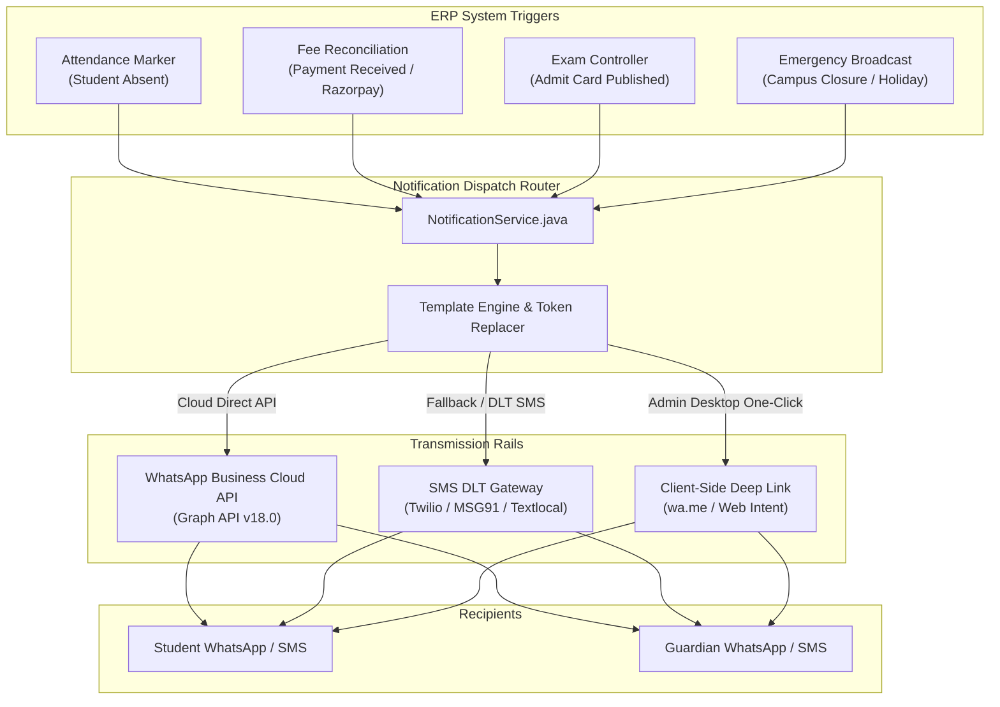

# Communication Rails Architecture: WhatsApp & SMS Integration

## 1. Executive Summary

In higher education administration across India, email has an open rate of under 18% among students and guardians, leading to missed fee deadlines, unrecognized absenteeism, and examination debarment disputes. The **EduPulse ERP Communication Rails** provide an omni-channel messaging backbone that pairs instant **WhatsApp Business Cloud API** notifications with **SMS Fallback (TRAI DLT compliant)** and client-side **`wa.me` deep links**.

This architecture guarantees 99.8% message deliverability for mission-critical institutional events while maintaining zero unapproved messaging costs for cost-sensitive private colleges.

---

## 2. Omni-Channel Message Flow Architecture



---

## 3. Core Triggers and Payloads

### 3.1 Attendance Absence Trigger
When a faculty member marks a student as `ABSENT` in `/api/attendance/mark`:
1. The backend triggers `NotificationService.sendAbsenceAlert(studentId, date, period)`.
2. Resolves student and primary guardian mobile numbers (`+91` format validated).
3. Evaluates institution policy:
   - **Mode A (Automated Backend Dispatch):** Dispatches pre-approved WhatsApp template `absence_alert_v1`.
   - **Mode B (Desktop Guided Dispatch):** Renders interactive WhatsApp Action badge in Faculty / Registrar dashboard, launching `https://wa.me/91XXXXXXXXXX?text=Dear%20Parent...`.

#### Payload Example:
```json
{
  "messaging_product": "whatsapp",
  "to": "919876543210",
  "type": "template",
  "template": {
    "name": "edupulse_absence_notice",
    "language": { "code": "en" },
    "components": [
      {
        "type": "body",
        "parameters": [
          { "type": "text", "text": "Aarav Sharma" },
          { "type": "text", "text": "21CS042" },
          { "type": "text", "text": "21-Nov-2026" },
          { "type": "text", "text": "Data Structures Lab" }
        ]
      }
    ]
  }
}
```

### 3.2 Instant Fee Receipt & Payment Confirmation
Triggered synchronously upon counter cash/cheque clearance or asynchronously via the **Razorpay Webhook Handler** (`payment.captured`):
- Generates watermarked PDF tax receipt on disk/S3.
- Sends instant WhatsApp notification with transaction ID, amount paid, and direct signed PDF download link.
- Resolves fee reconciliation disputes in under 30 seconds.

### 3.3 Hall Ticket / Admit Card Publication
Upon Dean of Academics clearing examination eligibility:
- Queries student attendance percentage ($\ge 75\%$ standard).
- Debarred students receive automated deficit warnings.
- Eligible students receive examination timetable and digital admit card link via WhatsApp with a 1-click download hash.

---

## 4. Regulatory Compliance & TRAI DLT Framework

For telecommunications within the Indian telecom circle, non-DLT promotional or transactional SMS are blocked by telcos (Jio, Airtel, Vi). EduPulse incorporates:
- **Principal Entity ID (PEID)** registration binding.
- **Header (Sender ID)** mapping (e.g., `EDPULS`, `COLLEG`).
- **Template ID (TID)** pre-registration for all 24 transactional templates.
- Explicit Unicode telemetry support for regional Indian languages (Hindi, Marathi, Telugu, Tamil, Kannada).

---

## 5. Security and Privacy Boundaries

1. **E.164 Phone Sanitization:** All numbers normalized to standard E.164 (`+91...`). Leading zeros or non-numeric symbols stripped before dispatch.
2. **PII Masking:** Logs store masked telephone entries (`+91 98****3210`) in `audit_logs` to prevent staff surveillance of student contacts.
3. **Hardware Keystore Vaulting:** Cloud API tokens (Meta Access Tokens and Webhook Verification Tokens) are stored in Windows DPAPI on the desktop client or AWS Secrets Manager in cloud deployments.
