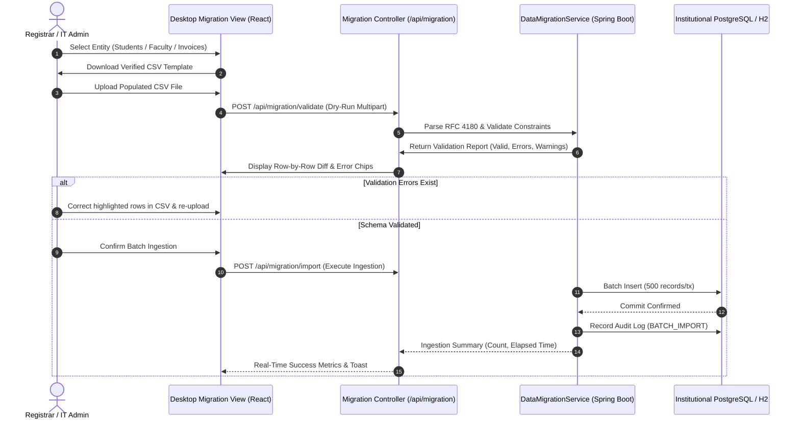

# Bulk Data Migration and Institution Onboarding Engine

## 1. Executive Summary

Legacy university systems rely heavily on ad-hoc Excel spreadsheets, fractured Access databases, or unsupported local desktop software. Transitioning a 5,000-student campus to a modern ERP usually stalls during data migration due to format inconsistencies, missing foreign keys, and batch failure rollovers.

The **EduPulse Bulk Data Migration Engine** (`DataMigrationService.java` & `DataMigration.tsx`) provides a two-phase transactional onboarding pipeline. It incorporates RFC 4180 client/server CSV parsing, pre-flight schema validation, dry-run error telemetry, and multi-tenant partitioned batch insertion.

---

## 2. Ingestion Pipeline Architecture



---

## 3. Supported Entity Schemas and Contracts

### 3.1 Student Roster Ingestion (`STUDENT`)
| Field Name | Type | Required | Validation Rules | Description |
| :--- | :--- | :--- | :--- | :--- |
| `enrollmentNumber` | String | Yes | Unique regex `^[A-Z0-9]{6,16}$` | University Roll / PRN |
| `firstName` | String | Yes | Non-blank, max 60 chars | Student First Name |
| `lastName` | String | Yes | Non-blank, max 60 chars | Student Last Name |
| `email` | String | Yes | Standard RFC 5322 regex | Institutional / Personal Email |
| `phoneNumber` | String | Yes | E.164 (`+91XXXXXXXXXX`) | Mobile for SMS/WhatsApp |
| `departmentCode` | String | Yes | Foreign key check (`dept_code`) | e.g., `CSE`, `MECH`, `ECE` |
| `academicYear` | Integer| Yes | Range `1..5` | Current Year of Study |
| `semester` | Integer| Yes | Range `1..10` | Current Academic Semester |
| `category` | String | No | Enum: `GENERAL`, `OBC`, `SC`, `ST`, `EWS` | Statutory reservation category |
| `gender` | String | Yes | Enum: `MALE`, `FEMALE`, `OTHER` | Gender identity |

### 3.2 Faculty Roster Ingestion (`FACULTY`)
- Validates employee code uniqueness.
- Maps cadre: `PROFESSOR`, `ASSOCIATE_PROFESSOR`, `ASSISTANT_PROFESSOR`, `LECTURER`.
- Enforces terminal degree flag (`phd_holder = true/false`) for NAAC Criterion 2 calculation.

### 3.3 Historical Fee Ledger Ingestion (`FEE_INVOICE`)
- Validates invoice numbers against existing accounts.
- Enforces financial invariants: `paid_amount <= total_amount`.
- Maps payment method: `CASH`, `CHEQUE`, `NEFT_RTGS`, `ONLINE`.

---

## 4. Pre-Flight Validation Engine

The engine parses the incoming stream using Apache Commons CSV in streaming mode to keep memory overhead below 20MB even for files containing 50,000+ records:

```java
CSVFormat format = CSVFormat.Builder.create()
    .setHeader()
    .setSkipHeaderRecord(true)
    .setIgnoreHeaderCase(true)
    .setTrim(true)
    .build();
```

### Error Reporting Model
Validation failures return structured diagnostics indicating:
- **`rowNumber`**: Physical CSV row number (accounting for header offset).
- **`field`**: Offending column key.
- **`invalidValue`**: Raw input value provided.
- **`errorMessage`**: Actionable message (e.g., `Department 'AERO' does not exist in institution registry`).

---

## 5. Fault Tolerance & Transactional Integrity

1. **Chunked Execution:** Records are grouped into chunks of 500 rows. Each chunk executes within an isolated Spring `@Transactional` block.
2. **Atomic Rollback on Request:** Administrators can toggle `abortOnFirstError` (default: `true` for initial setup; `false` with error quarantine file for large migrations).
3. **Audit Trail Logging:** Every migration job writes an immutable entry into `system_audit_logs` capturing user ID, IP address, original filename, total rows processed, and execution duration.
