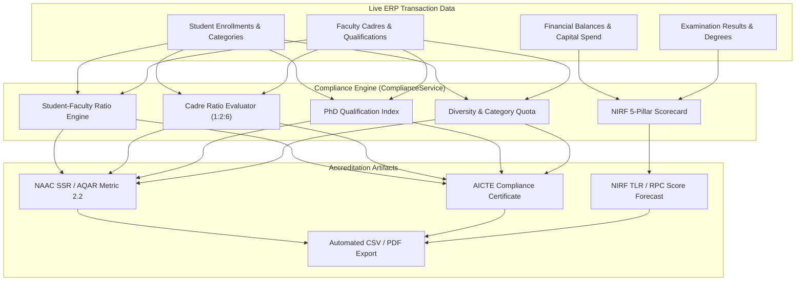

# Regulatory Compliance Engine: NAAC & NIRF Accreditation Hub

## 1. Executive Summary

Higher education institutions in India are governed by statutory accreditation mandates enforced by the **National Assessment and Accreditation Council (NAAC)** and the **National Institutional Ranking Framework (NIRF)**. Accreditation grades directly dictate UGC autonomous status, government research grants, and student enrollment caps.

Traditionally, institutions spend 4 to 6 months compiling Annual Quality Assurance Reports (AQAR) from siloed departments. The **EduPulse Compliance Engine** (`ComplianceService.java` & `ComplianceDashboard.tsx`) provides continuous, real-time calculation of accreditation metrics directly from live ERP transactional data.

---

## 2. Core Compliance Metrics & Formulas

---

## 3. Statutory Criteria Implementation

### 3.1 Student-Faculty Ratio (SFR) - NAAC Metric 2.2.2 / AICTE Norms
Calculated dynamically as:
$$\text{SFR} = \frac{\text{Total Full-Time Enrolled Students}}{\text{Total Regular Approved Faculty}}$$

- **AICTE Engineering Standard:** $\le 15:1$ (Compliant) or $\le 20:1$ (Acceptable).
- **System Thresholds:**
  - $\le 15.0$: `COMPLIANT` (Green indicator, Maximum NAAC Grade Points).
  - $15.1 - 20.0$: `ACCEPTABLE` (Yellow indicator, Requires Faculty Sanction Review).
  - $> 20.0$: `DEFICIENT` (Red indicator, Flags immediate hiring need).

### 3.2 AICTE Faculty Cadre Ratio
For engineering and technical departments, AICTE mandates a faculty hierarchy ratio of:
$$1 \text{ Professor} : 2 \text{ Associate Professors} : 6 \text{ Assistant Professors}$$

The engine evaluates actual staff rosters per department and flags senior cadre deficits that could penalize institutional tier rankings.

### 3.3 Faculty PhD Qualification Index - NAAC Metric 2.4.2
$$\text{PhD Qualification \%} = \left( \frac{\text{Faculty with Ph.D. / D.Sc. / D.Litt.}}{\text{Total Sanctioned Faculty}} \right) \times 100$$
Evaluates research readiness and doctoral mentorship capacity.

### 3.4 Student Diversity & Quota Compliance (Central & State Norms)
Tracks aggregate representation across demographic segments:
- **General Merit:** Target $\le 50\%$
- **OBC / Non-Creamy Layer:** Standard allocation $27\%$
- **SC (Scheduled Castes):** Standard allocation $15\%$
- **ST (Scheduled Tribes):** Standard allocation $7.5\%$
- **EWS (Economically Weaker Sections):** Standard allocation $10\%$
- **Gender Inclusivity Ratio:** Male to Female student and faculty balance.

---

## 4. NIRF Five-Pillar Composite Scorecard

The engine computes preliminary scores across the key NIRF dimensions:
1. **TLR (Teaching, Learning & Resources) [Weight: 0.30]:**
   - Student strength including doctoral students.
   - Faculty-student ratio with emphasis on permanent faculty.
   - Combined metric for faculty with PhD and experience.
   - Financial resources and their utilization.
2. **RPC (Research and Professional Practice) [Weight: 0.30]:**
   - Publications and citations indexed in Scopus / Web of Science.
   - Intellectual property and patents published/granted.
   - Sponsored research funding.
3. **GO (Graduation Outcomes) [Weight: 0.20]:**
   - Metric for university examinations pass percentage.
   - Median placement packages and higher studies progressions.
4. **OI (Outreach and Inclusivity) [Weight: 0.10]:**
   - Percentage of students from other states/countries.
   - Percentage of women students and faculty.
   - Facilities for physically challenged students.
5. **PR (Perception) [Weight: 0.10]:**
   - Peer perception and employer feedback surveys.

---

## 5. Security, Auditing & Export

- **Role-Based Access Control:** Only users with `ROLE_ADMIN`, `ROLE_PRINCIPAL`, or `ROLE_IQAC_DIRECTOR` can access the Compliance Hub.
- **Audit Immutability:** Any administrative override or manual baseline entry produces an entry in `system_audit_logs`.
- **Export Formats:** Direct export to NAAC-formatted CSV spreadsheets and printable PDF summaries for Board of Governors review.
