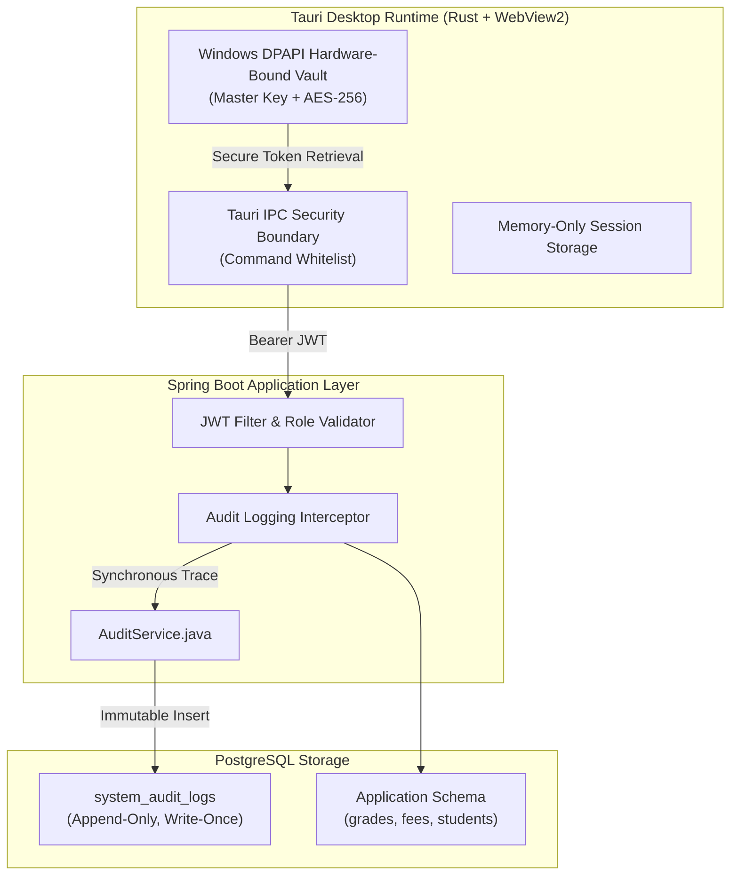

# Tamper-Evident Audit Trail and Security Architecture

## 1. Executive Summary

Educational institutions manage high-liability transactional data including official grade records, examination scores, cash receipts, and fee concessions. Internal fraud, unauthorized grade inflation, and retroactive fee modifications pose severe legal and reputational risks to universities.

The **EduPulse Security & Audit Subsystem** implements an append-only, tamper-evident audit logging architecture (`AuditLog.java`, `AuditService.java`, and `AuditLogs.tsx`) coupled with hardware-bound Windows DPAPI credential vaulting in the desktop runtime.

---

## 2. Multi-Layer Security Architecture



---

## 3. Tamper-Evident Audit Ledger

### 3.1 Data Model Specification (`system_audit_logs`)
| Column | Type | Constraints | Description |
| :--- | :--- | :--- | :--- |
| `id` | BIGINT | PRIMARY KEY, AUTO_INCREMENT | Monotonic event sequence ID |
| `action` | VARCHAR(64) | NOT NULL | Operation enum (e.g., `GRADE_UPDATE`, `FEE_OVERRIDE`) |
| `entity_type` | VARCHAR(64) | NOT NULL | Target entity (`Grade`, `StudentInvoice`, `Attendance`) |
| `entity_id` | VARCHAR(128) | NOT NULL | Primary key of modified entity |
| `performed_by` | VARCHAR(128) | NOT NULL | Username / Staff ID of operator |
| `ip_address` | VARCHAR(64) | NOT NULL | Client IP / Localhost origin |
| `details` | TEXT | NULLABLE | JSON payload of before/after delta |
| `status` | VARCHAR(32) | NOT NULL | `SUCCESS`, `FAILURE`, `DENIED` |
| `created_at` | TIMESTAMP | NOT NULL | UTC timestamp set by database clock |

### 3.2 High-Risk Operations Monitored
The audit engine mandatorily intercepts:
1. **Grade & Marks Alterations:** Records former grade, newly assigned grade, faculty ID, and Dean's override justification.
2. **Fee Waivers & Adjustments:** Captures invoice ID, original balance, waived amount, and approving authority.
3. **Bulk Data Ingestion:** Logs total inserted rows, file checksum, and administrator session.
4. **Role & Privilege Escalation:** Logs any role alteration or account unlock event.
5. **Session Revocations & Password Resets:** Full forensic trace of authentication lifecycle events.

---

## 4. Hardware-Bound Token Storage (Windows DPAPI)

In standard web applications, JWT tokens stored in `localStorage` or cookies are vulnerable to Cross-Site Scripting (XSS) extraction. In the EduPulse Desktop client:
- Tokens are encrypted via the Windows **Data Protection API (DPAPI)** using machine- and user-specific keys.
- Encryption key is tied to the operating system user profile:
  ```rust
  // Conceptual Windows DPAPI binding in Rust
  use windows_sys::Win32::Security::Cryptography::{CryptProtectData, CryptUnprotectData};
  ```
- The plain-text token is never written to disk or accessible to third-party Windows processes without the user's logged-in identity.
- On application shutdown or explicit logout, tokens in memory and cached descriptors are securely zeroed.

---

## 5. Non-Repudiation and Forensic Integrity

- **Database-Level Protection:** In cloud deployments, the PostgreSQL `system_audit_logs` table has row-level security (`REVOKE UPDATE, DELETE ON system_audit_logs FROM public, app_user`).
- **Forensic Querying:** The administrative console (`AuditLogs.tsx`) allows filtering across date ranges, user identities, action categories, and entity types, with instant CSV export for statutory compliance audits.
