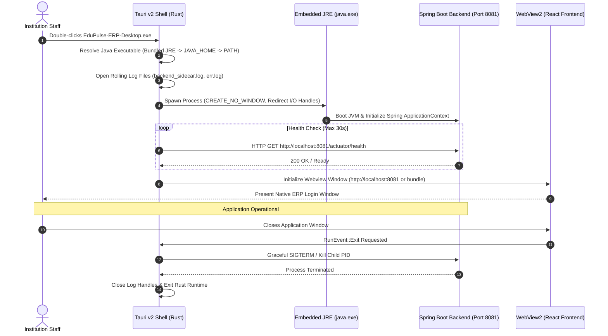

# Desktop Launcher and Backend Sidecar Lifecycle Management

## 1. Executive Summary

Traditional desktop deployments of multi-tier enterprise systems often suffer from user-unfriendly launcher scripts, flashing command-line consoles, orphaned background processes, and unhandled I/O pipe deadlocks.

The **EduPulse Desktop Launcher** operates as a native Tauri v2 (Rust) shell hosting a Microsoft Edge WebView2 rendering engine. The Rust runtime autonomously manages the lifecycle of the Spring Boot Java backend (`institutional-erp-backend.jar`) as an embedded, isolated sidecar process.

---

## 2. Process Lifecycle Architecture



---

## 3. Key Engineering Highlights & Hardening

### 3.1 Headless Execution (`CREATE_NO_WINDOW`)
To ensure an enterprise-grade experience without unsightly terminal flashes:
- The process creation flags on Windows pass `0x08000000` (`CREATE_NO_WINDOW`).
- Terminal command wrappers and standard shell invocations are completely bypassed.

### 3.2 Pipe Deadlock Prevention via File Redirection
When a Java process produces extensive logging (Hibernate SQL queries, Flyway migration logs, Spring bean instantiation), standard OS pipe buffers (typically 4KB to 64KB on Windows) fill quickly:
- If standard `Stdio::piped()` is used without an active consumer thread, the child process **deadlocks permanently** waiting for the buffer to flush.
- EduPulse redirects standard output and standard error directly to native rolling log files:
  - `backend_sidecar.log`
  - `backend_sidecar_err.log`
- This offloads I/O to the filesystem cache and guarantees zero-deadlock execution.

### 3.3 Elimination of Browser Mixed Content Blocks
- In Tauri v2, configuring custom HTTPS schemes (such as `useHttpsScheme: true`) enforces strict browser security models in WebView2.
- In this mode, fetch calls from `https://tauri.localhost` to `http://localhost:8081` are blocked by WebView2 as mixed content (`Blocked loading mixed active content`).
- EduPulse Desktop harmonizes the protocol scheme, permitting reliable, low-latency REST calls to the local loopback backend without certificate complications.

### 3.4 Clean Child Process Termination Hook
- On Windows, if a parent desktop executable is closed without an explicit lifecycle monitor, child Java processes continue running in the background, locking port `8081` and holding file locks on embedded databases.
- The Tauri run loop intercepts `RunEvent::Exit` and `RunEvent::WindowEvent { event: WindowEvent::Destroyed, .. }`:
  ```rust
  // Guaranteed child termination on application close
  if let Some(mut child) = child_process_handle.lock().unwrap().take() {
      let _ = child.kill();
  }
  ```
- This ensures zero ghost processes remain upon application shutdown.
