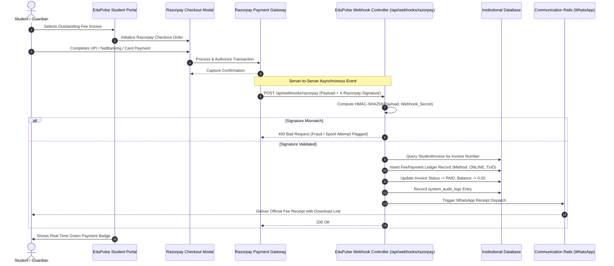

# Server-Side Payment Reconciliation and Webhook Architecture

## 1. Executive Summary

Online fee collection in educational institutions is fraught with dropped transactions, payment gateway timeouts, browser window premature closures, and payment fraud. Relying solely on client-side redirect callbacks (`window.location.href`) allows fraudulent manipulation of client parameters.

The **EduPulse Payment Reconciliation Engine** (`RazorpayWebhookController.java`) implements an authoritative server-to-server webhook consumer with **HMAC-SHA256 cryptographic verification**, transactional invoice reconciliation, and automatic real-time WhatsApp receipt generation.

---

## 2. Server-to-Server Webhook Flow



---

## 3. Cryptographic Verification Specification

Every webhook payload received from Razorpay is validated against the institutional webhook secret using HMAC-SHA256:

$$\text{Expected Signature} = \text{HexEncode}\left( \text{HMAC-SHA256}(\text{Raw Payload Body}, \text{Secret}) \right)$$

### Verification Implementation (`RazorpayWebhookController.java`)
```java
Mac sha256_HMAC = Mac.getInstance("HmacSHA256");
SecretKeySpec secret_key = new SecretKeySpec(webhookSecret.getBytes(StandardCharsets.UTF_8), "HmacSHA256");
sha256_HMAC.init(secret_key);
byte[] hash = sha256_HMAC.doFinal(payload.getBytes(StandardCharsets.UTF_8));
String calculatedSignature = Hex.encodeHexString(hash);

if (!calculatedSignature.equals(signatureHeader)) {
    auditService.logSecurityEvent("PAYMENT_SPOOF_ATTEMPT", "Signature verification failed", ipAddress);
    return ResponseEntity.status(HttpStatus.BAD_REQUEST).body("Invalid signature");
}
```

---

## 4. Idempotency and State Synchronization

1. **Idempotent Handling:** If Razorpay retries webhook delivery due to temporary network jitter, the engine checks whether the transaction ID (`payment_id`) is already recorded in the `FeePayment` table:
   - If present: Immediately returns `200 OK` without re-crediting the student or creating duplicate ledger entries.
   - If absent: Executes atomic settlement within a `@Transactional` block.
2. **Partial vs Full Payments:** Supports both full fee settlement and configurable installment allocations.
3. **Immediate Receipt Generation:** Generates the digital receipt number following the format `RCP-YYYYMMDD-XXXX` and notifies the payer via WhatsApp within 1,500ms of gateway capture.
