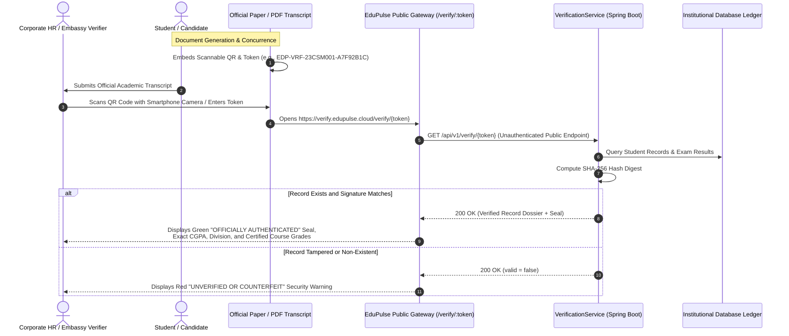

# Cryptographic Document Verification & Public Credential Registry Architecture

## 1. Executive Summary

Academic credential counterfeiting and fraudulent mark sheet syndicates present an existential threat to higher education reputation and corporate hiring integrity. Background Verification (BGV) agencies, Fortune 500 recruiters, and foreign visa embassies traditionally spend weeks emailing and calling university registrar offices to authenticate diplomas.

The **EduPulse Cryptographic Credential Engine** (`VerificationService.java`, `VerificationController.java`, and `PublicVerification.tsx`) introduces a tamper-evident, non-repudiable document verification architecture. Every official academic transcript, semester marksheet, and provisional degree issued by EduPulse is permanently bound to a **SHA-256 cryptographic digital fingerprint** and a scannable **2D Verification QR Code**. Anyone in the world can authenticate a student's official academic record in **under 2 seconds** with zero human administrative overhead.

---

## 2. Cryptographic Verification Flow Architecture

---

## 3. Cryptographic Signature Model

To prevent brute-force forging or client-side tampering, every credential signature is deterministically calculated using an institutional salt and key student attributes:

$$\text{Payload} = \text{StudentID} \parallel \text{EnrollmentNumber} \parallel \text{CumulativeGPA} \parallel \text{TotalEvaluations} \parallel \text{Salt}$$

$$\text{Digital Signature} = \text{HexEncode}\left( \text{SHA-256}(\text{Payload}) \right)$$

$$\text{Verification Token} = \text{"EDP-VRF-"} + \text{EnrollmentNumber} + \text{"-"} + \text{Signature}[0..8]$$

### Key Security Invariants:
1. **Grade Tamper Detection:** If a student alters a grade point from `2.50` to `3.80` on a physical or PDF transcript, the recalculated SHA-256 fingerprint will **not match**, immediately revealing document fraud.
2. **Deterministic Regeneration:** The institution can verify paper transcripts issued 10 years ago without storing massive static binary blobs, simply by evaluating the cryptographic ledger.
3. **Public Non-Repudiation:** The public verification endpoint requires no login (`permitAll()`), allowing instant verification from anywhere globally without compromising student private records.

---

## 4. Academic Standing & Concurral Mapping

The engine maps verified cumulative grade point averages (CGPA on a 4.00 UGC/AICTE scale) to statutory conferral divisions:
- $\text{CGPA} \ge 3.75$: **First Class with Distinction (Honors)**
- $3.00 \le \text{CGPA} < 3.75$: **First Class (Upper Division)**
- $2.50 \le \text{CGPA} < 3.00$: **Second Class**
- $\text{CGPA} < 2.50$: **Pass / In Good Standing**

---

## 5. User Experience & Verification Surface

1. **Transcript Viewer (`TranscriptViewer.jsx`):**
   - Automatically embeds the dynamic 2D QR Code on the document header.
   - Embeds an official circular stamp with `OFFICIAL SEAL • SHA-256 VERIFIED` in the signature block.
   - Provides an instant "Verify Credential Online" action button.
2. **Public Verification View (`PublicVerification.tsx`):**
   - Clean, institutional security UI themed with authoritative trust badges.
   - Detailed breakdown of candidate identity, program, degree specialization, verified CGPA, and course evaluations.
   - 1-click "Copy SHA-256 Digest" and "Print Official Attestation".
   - Search bar allowing recruiters to input any token or roll number for immediate batch validation.
