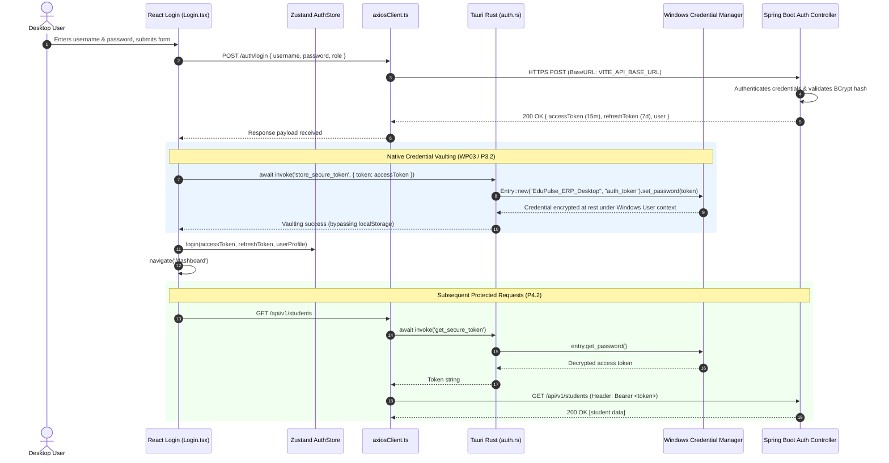

# EduPulse ERP — Desktop v1 Engineering Baseline
## Deliverable P0.3: Desktop Architecture Baseline & API/Auth Contract

**Specification Reference:** Section P0.3 | Global Release Gate G1  
**Date:** 13 November 2026  
**Auditor:** Lead Desktop Integration Architect  

---

## 1. Executive Summary

This document establishes the verified architectural baseline and API/authentication contract for **EduPulse ERP Windows Desktop Edition**. It traces the end-to-end authentication lifecycle from React UI submission through Tauri IPC to Windows Credential Manager and Spring Boot REST endpoints, distinguishing shared web code from desktop-specific native code.

---

## 2. End-to-End Authentication Lifecycle & Contracts

---

## 3. Web-Only vs. Desktop-Only Code Paths

To satisfy **Cross-Cutting Rule 5** and **P6.1 (Runtime Abstraction)**, the codebase enforces strict separation between web and desktop execution:

| Functional Area | Web Mode Execution | Desktop Mode Execution | Abstraction Mechanism |
| :--- | :--- | :--- | :--- |
| **Runtime Detection** | Standard Browser DOM | `window.__TAURI_INTERNALS__` present | `isTauriDesktop()` utility probe. |
| **Token Storage** | Browser `localStorage` (`auth-storage`) | Windows Credential Manager / DPAPI | Native IPC commands: `store_secure_token`, `get_secure_token`. |
| **API Token Injection** | Synchronous read from `localStorage` | Asynchronous IPC via `await invoke('get_secure_token')` | `axiosClient.interceptors.request.use(async ...)`. |
| **Base URL Resolution** | `import.meta.env.VITE_API_BASE_URL` or relative `/api` | `import.meta.env.VITE_API_BASE_URL` or `http://localhost:8081` | Dynamic Axios `baseURL` property. |
| **Session Teardown** | Clear `localStorage` on logout | Clear in-memory Zustand store + `clear_secure_token` IPC | Explicit logout handler hook. |

---

## 4. Current Tauri IPC Commands & Capabilities

The following native commands are declared in `src-tauri/src/auth.rs` and registered in `main.rs`:

| Command Name | Input Arguments | Return Type | Security & Error Behavior |
| :--- | :--- | :--- | :--- |
| `store_secure_token` | `token: String` | `Result<(), String>` | Rejects empty strings. Persists to Windows Credential Manager service `"EduPulse_ERP_Desktop"`. |
| `get_secure_token` | None | `Option<String>` | Returns `Some(token)` if present. Returns `None` on missing entry or decryption failure. |
| `clear_secure_token` | None | `Result<(), String>` | Removes the entry from Windows Credential Manager upon application logout. |

### Capability Policy Status (P2.2)
- **Current State:** Default Tauri v2 capability configuration in `src-tauri/tauri.conf.json`.
- **Target Policy for Phase P2.2:** Formulate `src-tauri/capabilities/default.json` restricting `store_secure_token` and `get_secure_token` invocation exclusively to `http://tauri.localhost` / `https://tauri.localhost`.

---

## 5. Backend API & Session Defect Register (R1–R6)

The desktop authentication flow is constrained by six known defects in the Spring Boot backend (`backend/`):

| Defect ID | Severity | Defect Description | Impact on Desktop Client | Remediation Phase |
| :--- | :--- | :--- | :--- | :--- |
| **R1** | **CRITICAL** | In-memory token blacklist in `TokenBlacklistService`. | Server restart resurrects revoked desktop tokens. | P3.1 / P3.3 |
| **R2** | **CRITICAL** | Session registry keyed only by `username`. | Logging in from desktop kicks out active web session for the same user. | P3.4 |
| **R3** | **HIGH** | `/api/v1/auth/logout` only revokes access token; refresh token remains valid. | Logging out does not revoke the persistent 7-day refresh token on the server. | P3.3 |
| **R4** | **HIGH** | Password changes do not invalidate active sessions. | Compromised user credentials remain active on desktop until JWT expiry. | P3.4 |
| **R5** | **HIGH** | `JwtAuthenticationFilter` validates signature statelessly without checking `user.isEnabled()`. | Deactivated or suspended users retain API access until token expiration. | P3.4 |
| **R6** | **MEDIUM** | Refresh-token family reuse detection lacks complete descendant revocation. | Stolen refresh tokens can fork session trees. | P3.3 |

---

## 6. Acceptance Sign-Off for P0.3

- [x] Architecture reflects actual code paths in `src-tauri/`, `src/api/`, and `frontend-v2/`.
- [x] Web-only vs desktop-only branches are catalogued.
- [x] End-to-end authentication lifecycle and token contracts are documented.
- [x] Known backend session defects (R1–R6) are registered with clear phase mappings.

**P0.3 Status:** **COMPLETE & VERIFIED**
