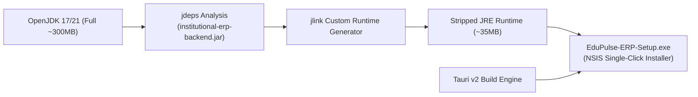
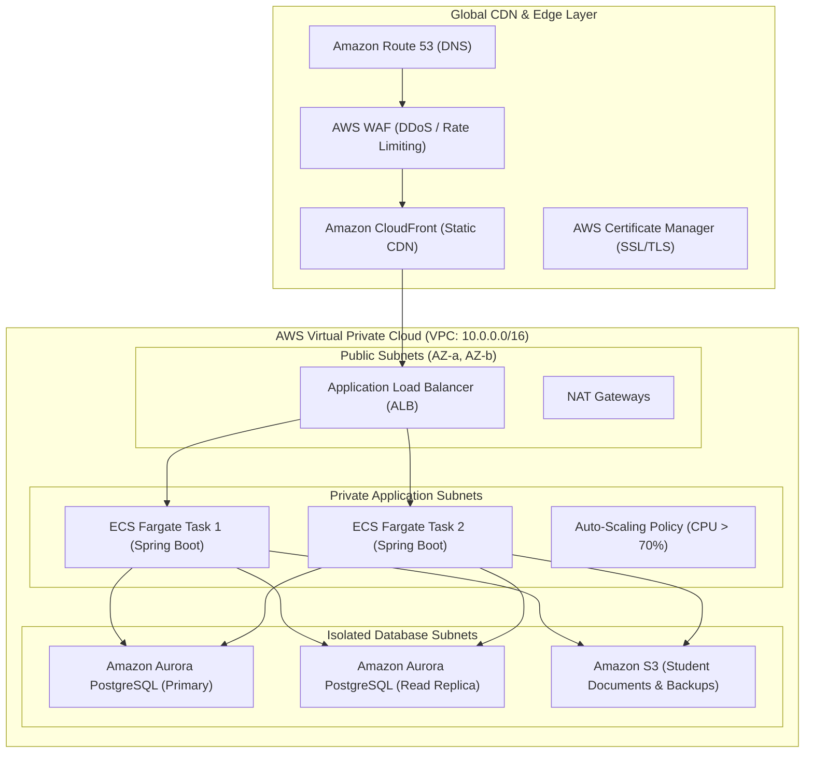

# Production Deployment and Zero-Prerequisite Packaging Guide

## 1. Executive Summary

This guide specifies production deployment topologies and client distribution strategies for EduPulse ERP:
1. **Desktop Client Distribution:** Zero-dependency Windows packaging using **Tauri v2** and customized, stripped-down JRE runtimes created with **`jlink`** (~35 MB).
2. **Cloud Backend Deployment:** Enterprise Multi-Tenant SaaS topology on **Amazon Web Services (AWS)** using ECS Fargate, Aurora Serverless PostgreSQL, Route 53, and CloudFront.

---

## 2. Desktop Zero-Prerequisite Distribution (Windows NSIS / MSI)

To deploy to institutional administrative offices where staff lack local administrator rights or pre-installed Java runtimes, EduPulse packages the backend with a customized modular JRE.



### 2.1 Generating Minimal Bundled JRE via `jlink`
Run the following script to produce a headless JRE containing only required Spring Boot modules:

```bash
# 1. Analyze JAR dependencies
jdeps --ignore-missing-deps --multi-release 17 --print-module-deps backend/institutional-erp-backend.jar > modules.txt

# 2. Assemble minimal modular runtime
jlink \
  --module-path "$JAVA_HOME/jmods" \
  --add-modules java.base,java.sql,java.naming,java.desktop,java.management,java.security.jgss,java.instrument \
  --strip-debug \
  --no-man-pages \
  --no-header-files \
  --compress=2 \
  --output ./dist/jre

# Result: Reduced from 320 MB to ~38 MB
```

### 2.2 NSIS Installer Configuration (`tauri.conf.json`)
The installer places the customized JRE in the installation folder under `resources/jre`:
- Single-click desktop installation.
- No Java prompt, no environment variable edits required.
- Auto-detects and installs Microsoft Edge WebView2 runtime if missing.

---

## 3. Enterprise Cloud Deployment Topology (AWS)



---

## 4. Production Environment Configuration (`application-prod.yml`)

```yaml
spring:
  datasource:
    url: jdbc:postgresql://${DB_HOST:aurora-cluster.internal}:5432/${DB_NAME:edupulse_prod}?sslmode=require
    username: ${DB_USER}
    password: ${DB_PASS}
    hikari:
      maximum-pool-size: 30
      minimum-idle: 10
      idle-timeout: 300000
      max-lifetime: 1800000
  jpa:
    hibernate:
      ddl-auto: validate
    show-sql: false

edupulse:
  security:
    jwt:
      secret: ${JWT_SECRET_256BIT}
      expiration-ms: 86400000
  communication:
    whatsapp:
      api-token: ${WHATSAPP_CLOUD_TOKEN}
      phone-number-id: ${WHATSAPP_PHONE_ID}
    sms:
      provider: dlt-compliant
      api-key: ${SMS_GATEWAY_KEY}
  payment:
    razorpay:
      key-id: ${RAZORPAY_KEY_ID}
      key-secret: ${RAZORPAY_KEY_SECRET}
      webhook-secret: ${RAZORPAY_WEBHOOK_SECRET}
```

---

## 5. High Availability & Disaster Recovery

- **Multi-AZ Replication:** Aurora PostgreSQL automatically replicates across 3 availability zones with sub-second failover.
- **Automated Point-in-Time Recovery (PITR):** 35-day continuous backup retention.
- **S3 Glacier Archival:** Student examination and fee audit logs archived to Glacier Instant Retrieval with legal hold compliance.
